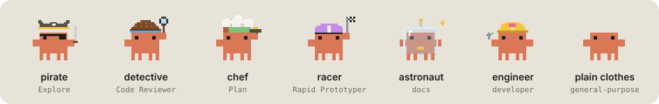

<div align="center">

# agent-crew

**Your Claude Code agents work in parallel. Now you can see them.**



</div>

When Claude Code spawns several subagents, they work silently: you can't tell how many are running, what they're doing, or which one is lagging behind. **agent-crew** makes them visible, with a little pixel-art Clawd per agent, dressed for its job.

## What you get

**A band above the prompt**, only while agents are running: the headcount ("3 agents in parallel · 1 done ›"), then one chip per agent with its Clawd, its name, elapsed time and current tool, all on a single line (`+N` when they no longer fit). Clicking the headcount opens the crew panel.

**A crew panel**, which opens by itself when the first agent starts (`/agents` to reopen it):

- one Clawd per agent, **walking and playing with its prop** while it works;
- it **closes its eyes** once its task is done, and gets **crossed-out eyes** if it fails;
- next to it: its description, type, elapsed time, number of tool calls and current tool.

**A notification** when the whole crew is done.

## The costumes

| Agent type | Costume | While working |
|---|---|---|
| `Explore`, search, grep | 🏴‍☠️ Pirate | fences with its cutlass |
| reviewer, checker, audit, security | 🔍 Detective | sweeps the code with its magnifier |
| `Plan`, architect | 🍳 Chef | flips the omelette |
| prototyper, `web-fetch` | 🏁 Racer | runs twice as fast, flag fluttering |
| docs, research, writer | 🚀 Astronaut | floats in zero gravity, antenna blinking |
| engineer, developer, devops | 🔧 Engineer | tightens a bolt |
| everything else | 🦀 Plain clothes | just walks |

Each agent keeps its own colour, carried by its costume. Animations are pure CSS and stop when your system asks for reduced motion.

## Installation

```sh
claude plugin marketplace add LudovicLaloux/agent-crew
claude plugin install agent-crew@agent-crew
```

Then open a new session and launch a few agents in parallel, for example: *"Launch 3 Explore agents in parallel to map this repo"*. The Clawds show up in the desktop app (Code tab) and in the terminal (see below).

**Update:**

```sh
claude plugin marketplace update agent-crew
claude plugin update agent-crew@agent-crew
```

**Uninstall:** `claude plugin uninstall agent-crew@agent-crew`

## In the terminal

The terminal has no SVG, so the crew panel draws the same Clawds pixel for pixel with half-block characters:

- each agent is a card: its Clawd, then its description, elapsed time and tool calls underneath;
- cards sit side by side and wrap onto new rows when the width runs out;
- a full-size Clawd is 30 columns × 14 rows; when the panel is too short for a full card, it is halved to 15 × 7 (one-pixel details such as the magnifier's ring or the racing flag get coarser);
- only the legs move, one step per second: the CSS animations of the desktop don't carry over;
- translucent pixels and finished agents are blended over a dark background, so they look darker than intended on a light terminal theme.

The band above the prompt has a single line, so it keeps text faces: `◖•ᴗ•◗` working, `◖ᵔᴗᵔ◗` done, `◖×_×◗` failed.

By default the panel opens above the prompt. With the fullscreen renderer (`"tui": "fullscreen"` in `~/.claude/settings.json`, or `CLAUDE_CODE_NO_FLICKER=1`), it docks as a sidebar beside the conversation once the terminal is at least 110 columns wide.

The Claude Code extension for VS Code doesn't draw mods yet: nothing shows there. Set `"claudeCode.useTerminal": true` in VS Code to run Claude in its integrated terminal instead.

## Contributing

The whole mod lives in one file, [`hooks/register.tsx`](hooks/register.tsx). Costumes are drawn pixel by pixel from small character grids, easy to tweak or extend.

```sh
claude --plugin-dir .      # try it without installing
claude plugin validate .
claude plugin test .
```

Remember to bump `version` in [`.claude-plugin/plugin.json`](.claude-plugin/plugin.json) with every change: an installation keeps a cached copy, which `claude plugin update` only refreshes on a new version.

## Credits

The pixel-art Clawd, its costumes and their animations are adapted from [savvy-progress](https://github.com/johnnyvizz/claude-kit/tree/main/plugins/savvy-progress) by johnnyvizz (MIT), itself traced from DockCrab.

## License

MIT, see [LICENSE](LICENSE).

Clawd is Anthropic's mascot. agent-crew is an unofficial community mod, not affiliated with or endorsed by Anthropic.
